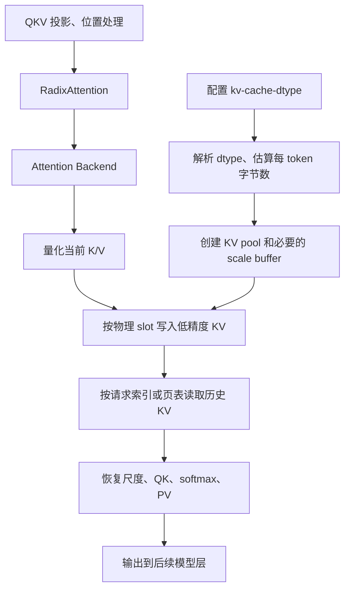

KV Cache 量化把运行时产生的 K/V 压缩保存，并让 attention 按相同的量化规则读取。完整实现包括配置、容量估算、低精度数据与 scale 存储、量化写入、attention 读取和缓存搬迁，不能只修改一个 dtype。

本文核对的源码版本为 [`8252e3af63`](https://github.com/sgl-project/sglang/tree/8252e3af630c103e960e13a77e570e810f8e3eb8)，核对日期为 2026-10-26。源码链接固定到该提交，避免后续重构改变含义。讨论以 GPU 上常规 MHA/GQA 为主；MLA 的 latent cache 和 Mamba/GDN 的 recurrent state 需要分别分析。

文中 FP8 部分描述已有实现；INT8 部分是接入设计，**不是已经可用的功能**。该版本通用 `--kv-cache-dtype` 没有 `int8` 选项。部署参数见 [Quantized KV Cache](/docs/advanced_features/quantized_kv_cache)，后端兼容性见 [Attention Backend](/docs/advanced_features/attention_backend)。

## 量化对象与 16 bit 基线

一次 attention 的数学过程可写为：

$$
Q=XW_Q,\quad K=XW_K,\quad V=XW_V
$$

$$
O=\operatorname{softmax}\left(\frac{QK^\top}{\sqrt D}+M\right)V
$$

其中 $D$ 是 Q/K 每个 head 的维度，$M$ 是 causal 等加性 mask。权重、当前激活、历史 KV 是三个不同的精度选择：

| 对象 | 生命周期 | 量化主要影响 |
| --- | --- | --- |
| 权重 $W_Q,W_K,W_V$ 等 | 模型加载后长期存在 | 权重显存、Linear/GEMM |
| 当前 Q/K/V 激活 | 每次 forward 产生 | 计算精度、临时显存 |
| 历史 KV Cache | 随请求增长、跨 forward 保留 | 上下文容量、attention 读取流量 |

权重 INT4 不代表 KV Cache 也是 INT4；KV Cache FP8 也不代表整个 attention 都执行 FP8 运算。FP16/BF16 KV Cache 通常称为未量化基线：直接保存浮点 K/V，没有额外的 KV 量化 scale。

假设各层 KV 头数相同，且 K/V head dimension 都为 $D$，缓存数据占用为：

$$
M_{\mathrm{KV}}=2LTH_{\mathrm{kv}}D\,b
$$

| 符号 | 含义 |
| --- | --- |
| $L$ | 缓存层数 |
| $T$ | 所有请求实际占用的物理 token slot 总数；共享前缀不重复计数 |
| $H_{\mathrm{kv}}$ | KV 头数；GQA 中通常小于 Q 头数 |
| $b$ | 每元素字节数：FP16/BF16 为 2，FP8/INT8 为 1 |
| 前面的 2 | K 和 V 两份缓存 |

多卡估算应使用当前 rank 实际持有的层数、KV 头数和 slot 数，不能一律将全模型占用除以 TP 数。8 bit 把 KV 数据部分减半，scale、对齐和 workspace 另算，也不代表整个服务显存减半。

## 框架到 kernel 的调用链



| 层次 | 源码入口 | 职责 |
| --- | --- | --- |
| 参数 | [fields/model.py](https://github.com/sgl-project/sglang/blob/8252e3af630c103e960e13a77e570e810f8e3eb8/python/sglang/srt/arg_groups/fields/model.py#L197) | 声明 `--kv-cache-dtype` |
| dtype 解析 | [kv_cache_dtype.py](https://github.com/sgl-project/sglang/blob/8252e3af630c103e960e13a77e570e810f8e3eb8/python/sglang/srt/mem_cache/kv_cache_dtype.py#L34) | 字符串映射到 dtype；处理 `auto` 和 draft 分支 |
| 容量估算 | [pool_configurator.py](https://github.com/sgl-project/sglang/blob/8252e3af630c103e960e13a77e570e810f8e3eb8/python/sglang/srt/model_executor/pool_configurator.py#L337) | 估算每 token 占用，决定池容量 |
| pool 选择 | [kv_cache_configurator.py](https://github.com/sgl-project/sglang/blob/8252e3af630c103e960e13a77e570e810f8e3eb8/python/sglang/srt/mem_cache/kv_cache_configurator.py#L435) | 选择缓存池和量化方法 |
| 缓存池 | [memory_pool.py](https://github.com/sgl-project/sglang/blob/8252e3af630c103e960e13a77e570e810f8e3eb8/python/sglang/srt/mem_cache/memory_pool.py#L2183) | 分配 K/V、管理布局和 slot 读写 |
| 模型入口 | [radix_attention.py](https://github.com/sgl-project/sglang/blob/8252e3af630c103e960e13a77e570e810f8e3eb8/python/sglang/srt/layers/radix_attention.py#L174) | 将 Q/K/V 交给 attention backend |
| 后端编排 | [flashinfer_backend.py](https://github.com/sgl-project/sglang/blob/8252e3af630c103e960e13a77e570e810f8e3eb8/python/sglang/srt/layers/attention/flashinfer_backend.py#L1521) | 写缓存、准备 scale 和索引、调用 attention |

该版本参数支持 `auto`、`fp8_e5m2`、`fp8_e4m3`、`mxfp8`、`bf16`、`bfloat16`、`nvfp4`、`fp4_mx_block16`。参数可解析不代表任意硬件和后端组合都可运行。

`auto` 通常使用模型 dtype，但当模型量化配置声明 FP8 KV 时可以解析成 FP8，因此不能简单理解为永远使用 BF16。

## 普通 FP8：scale、写入和读取

### scale 的语义和来源

这里讨论每层 K/V 各使用一个标量 scale 的普通 FP8 路径，不包含 MXFP8 或 FP4 的分块 scale 配方。对某一层：

$$
K_8=\operatorname{cast}_{\mathrm{FP8}}(K/s_K),\qquad
V_8=\operatorname{cast}_{\mathrm{FP8}}(V/s_V)
$$

$$
\widehat K=s_KK_8,\qquad \widehat V=s_VV_8
$$

scale 决定原始数值如何映射到 FP8 的可表示范围；转换产生舍入误差，超范围值还涉及具体转换实现的饱和或溢出行为。不同 kernel 的转换行为必须分别核对。

[BaseKVCacheMethod](https://github.com/sgl-project/sglang/blob/8252e3af630c103e960e13a77e570e810f8e3eb8/python/sglang/srt/layers/quantization/kv_cache.py#L18) 的职责是：

- 在 attention 层创建 FP32 的 `k_scale`、`v_scale` 参数，用于 checkpoint 加载；它们不是 K/V 数据。
- 加载后生成 `k_scale_float`、`v_scale_float`，供部分后端作为 host 标量传递。
- 没有加载到有效 scale 时回退到 1.0；这不是对当前数据执行自动校准。
- 检查普通 FP8 scale 是 per-tensor 标量，而非每个 token 或 channel 的数组。

也可以通过 `--quantization-param-path` 提供 scale JSON。具体模型和后端负责将加载结果接到 attention 层。**运行时量化 K/V，不等于每个 token 都重新计算 scale。**

### 写入 API 与缓存布局

[MHATokenToKVPool.set_kv_buffer](https://github.com/sgl-project/sglang/blob/8252e3af630c103e960e13a77e570e810f8e3eb8/python/sglang/srt/mem_cache/memory_pool.py#L2873) 的接口如下：

```python
def set_kv_buffer(
    self,
    layer: RadixAttention,
    loc_info,
    cache_k: torch.Tensor,
    cache_v: torch.Tensor,
    k_scale: Optional[float] = None,
    v_scale: Optional[float] = None,
    layer_id_override: Optional[int] = None,
    dcp_kv_mask: Optional[torch.Tensor] = None,
):
    ...
```

这是接口摘录，不是可独立运行的实现。常规 GPU 路径的参数契约为：

| 参数 | dtype / shape / 作用 |
| --- | --- |
| `layer` | 当前 `RadixAttention`，提供层号等元数据 |
| `loc_info` | 物理写入位置，可能由 `KVWriteLoc` 包装；解包后的 `loc` 是长度为 N 的整数索引 tensor，整数宽度由具体写入 kernel 决定 |
| `cache_k` | 通常为 GPU FP16/BF16 tensor，形状 `[N, Hkv_local, Dk]`；也存在已转换 dtype 的输入路径 |
| `cache_v` | 通常为 GPU FP16/BF16 tensor，形状 `[N, Hkv_local, Dv]` |
| `k_scale` / `v_scale` | K/V 量化除数；默认 `None` 表示不额外除以 scale。虽然注解是 `Optional[float]`，现有调用者也会传入标量 tensor |
| `layer_id_override` | 默认使用 `layer.layer_id`；非空时覆盖物理写入层号 |
| `dcp_kv_mask` | 可选的 decode context parallel 写入掩码；不是所有量化分支都支持 |
| 返回值 | 无 tensor 返回值；原地更新缓存，并可能修改传入 K/V |

`N` 是本次 forward 的新 token 数，`Hkv_local` 是当前 TP rank 上的 KV 头数。默认 token-major 布局中，每层缓存形状为：

```text
K_buffer: [capacity + padding, Hkv_local, Dk]
V_buffer: [capacity + padding, Hkv_local, Dv]
```

`loc[i]` 决定第 i 个输入 token 写入哪个物理 slot；输入 token 不需要在缓存中连续。HND 等其他布局会把 slot 再分解成 page 和页内 offset。

普通路径在输入 dtype 与缓存 dtype 不同时执行除 scale 和 dtype 转换，再散写到缓存。下面仅表示数值过程，省略原地操作和布局分支：

```text
K8 = cast_fp8(K / sK)
V8 = cast_fp8(V / sV)
K_buffer[loc] = K8
V_buffer[loc] = V8
```

源码中有 `cache_k.div_(k_scale)` 等原地操作。如果 prefill 随后还要使用原始 K/V，调用方必须避免输入被提前修改；Triton backend 的相关路径会先 clone。

### uint8 buffer 为什么不代表 INT8 量化

[KVCache 初始化](https://github.com/sgl-project/sglang/blob/8252e3af630c103e960e13a77e570e810f8e3eb8/python/sglang/srt/mem_cache/memory_pool.py#L2024) 对部分 FP8 dtype 使用 `torch.uint8` 作为底层 `store_dtype`，以兼容索引写入等操作。此时保存的是 FP8 原始编码，不是整数数值。

| 操作 | 含义 |
| --- | --- |
| `.to(dtype)` | 转换数值表示，可能产生舍入或溢出 |
| `.view(dtype)` | 用另一种 dtype 解释同一段字节，不执行数值反量化 |

因此 [get_key_buffer](https://github.com/sgl-project/sglang/blob/8252e3af630c103e960e13a77e570e810f8e3eb8/python/sglang/srt/mem_cache/memory_pool.py#L2817) 返回的 FP8 view 并没有将整个历史 KV 展开为 FP16。FP4 等其他分支可能有显式反量化 workspace，不能把普通 FP8 的行为推广到所有格式。

### attention 如何恢复 scale

当 $s_K,s_V$ 是该层共用的标量时，可以把尺度恢复写成：

$$
O=s_V\operatorname{softmax}\left(
\frac{s_K}{\sqrt D}QK_8^\top+M
\right)V_8
$$

- K scale 可以合并进 attention 的 `sm_scale`，在 softmax 前应用。
- V scale 可以移到加权求和后，乘最终输出。
- 不需要先把全部历史 KV 反量化到一个新的 FP16 HBM buffer。

当前 [Triton decode 入口](https://github.com/sgl-project/sglang/blob/8252e3af630c103e960e13a77e570e810f8e3eb8/python/sglang/kernels/ops/attention/decode_attention.py#L1191) 传入 `sm_scale * k_scale`，在[输出归约](https://github.com/sgl-project/sglang/blob/8252e3af630c103e960e13a77e570e810f8e3eb8/python/sglang/kernels/ops/attention/decode_attention.py#L1016)阶段乘 `v_scale`。

该公式解释 scale 的位置；实际点积使用的 dtype、Q/P 是否转换，以及是否利用 FP8 矩阵指令，仍取决于具体 kernel 和硬件。KV 存储格式、点积操作数格式和累加精度需要分别检查。

## C++、CUDA 与 Triton 的职责

SGLang 中两类调用方式都存在：

```text
Python backend → Triton kernel
Python backend → Python 算子封装 → JIT C++/CUDA 或外部 attention 库
```

普通缓存写入可以先转换 dtype，再调用 `store_cache` 散写。此时存储 kernel 主要负责按索引搬运字节，并不负责量化数学。参见 [kvcache.py](https://github.com/sgl-project/sglang/blob/8252e3af630c103e960e13a77e570e810f8e3eb8/python/sglang/kernels/ops/kvcache/kvcache.py#L27)。

已有优化实例是 TRT-LLM MHA backend 的融合 FP8 写入路径：

```text
trtllm_mha_backend._fused_fp8_qkv_kv_cache
  → fused_fp8_qkv_kv_cache(...)
  → load_jit(...)
  → FusedFp8QkvKvCache::run(...)
  → fused_fp8_qkv_kv_cache_kernel(...)
```

对应 [backend 调用](https://github.com/sgl-project/sglang/blob/8252e3af630c103e960e13a77e570e810f8e3eb8/python/sglang/srt/layers/attention/trtllm_mha_backend.py#L1026)、[Python 封装](https://github.com/sgl-project/sglang/blob/8252e3af630c103e960e13a77e570e810f8e3eb8/python/sglang/kernels/ops/kvcache/fused_fp8_qkv_kv_cache.py#L18) 和 [C++/CUDA 实现](https://github.com/sgl-project/sglang/blob/8252e3af630c103e960e13a77e570e810f8e3eb8/python/sglang/kernels/jit/csrc/attention/fused_fp8_qkv_kv_cache.cuh#L38)。

| 部分 | 工作 |
| --- | --- |
| Python 封装 | 整理 tensor、scale、输出和 JIT 特化参数 |
| C++ host 入口 | 检查 dtype、shape、stride、device，选择向量宽度并 launch |
| CUDA kernel | 每个 block 处理一个 token，查 `cache_loc`，读取 K/V，乘 scale 倒数，转 FP8，直接写目标 slot |

该 kernel 支持向量化访存、有 stride 的缓存；部分路径还同时转换 Q。它不是所有 FP8 backend 都必经的公共入口。

## 性能优化与收益边界

| 优化 | 减少的开销 | 注意事项 |
| --- | --- | --- |
| 低精度持久存储 | KV 容量和读取字节数 | 不能推出整个模型显存减半 |
| 量化与写入融合 | 中间 tensor、重复 HBM 读写、launch | 需要正确处理输入和缓存 stride |
| attention 内消费低精度 KV | 整个历史缓存的反量化 workspace | tile 内转换仍有计算成本 |
| scale 合并 | 逐元素独立乘法 | 依赖 scale 粒度，动态 token scale 不能照搬 |
| NHD/HND/向量化布局 | 非连续访存或布局转换 | writer 和 reader 必须使用同一物理布局 |
| CUDA Graph 友好参数 | host 同步、重复分配或填充 | forward 中避免 `.item()` 和设备到主机复制 |

长上下文 decode 常能受益于减少 KV 流量；短上下文可能主要受 launch 开销影响，prefill 可能更偏计算瓶颈。GQA 复用、并发度、backend 和硬件也会改变结果。本文没有给出实测加速比，不能把字节数减少直接当作端到端速度提升。

## INT8 与 FP8 的差别

| 项目 | FP16/BF16 | FP8 | 对称 INT8 |
| --- | --- | --- | --- |
| 元素存储 | 2 字节浮点 | 1 字节浮点 | 1 字节整数 |
| 编码分布 | 浮点、间距不均匀 | 指数和尾数、间距不均匀 | 整数编码等间距 |
| 写入 | 通常直接保存 | 缩放后浮点转换 | 缩放、舍入、截断 |
| 还原 | 无额外尺度 | $s x_{\mathrm{fp8}}$ | $s q_{\mathrm{int8}}$ |
| attention 适配 | 基线 | FP8 转换或原生 FP8 运算 | 整数转浮点，或另行设计整数计算 |

一种明确的对称 INT8 规则是：

$$
s=\frac{\max_i |x_i|}{127},\qquad
q_i=\operatorname{clip}\left(\operatorname{round}(x_i/s),-127,127\right),\qquad
\widehat{x_i}=s q_i
$$

全零组可以规定 $s=1$，编码全部为 0。需要明确 round 的 tie-breaking 规则，例如 round-to-nearest-even；这里只使用 INT8 的 `[-127, 127]` 对称范围，保留 `-128` 不用。非有限值应单独规定处理策略，不能让 NaN 静默污染 scale。

直接把 `.to(fp8)` 换成 `.to(torch.int8)` 不会自动实现上述规则。尤其需要显式舍入和饱和，且读取端必须收到正确的 scale。

INT8 KV 存储不等于 INT8 Tensor Core attention。Q 通常是浮点，softmax 得到的 P 也是浮点；若要让 QK 和 PV 都进入整数矩阵乘，还需要为 Q/P 设计量化、scale 和累加恢复规则。

## INT8 接入设计

### 首版范围与 scale 粒度

一个便于验证的起点是：GPU 常规 MHA/GQA、一个 Triton backend、对称 INT8、每个 token 的每个 KV head 独立 scale，attention 在 tile 内恢复到计算 dtype。先支持完整 prefill、chunked prefill、prefix reuse 和 decode；对尚未适配的 MLA、特殊布局、投机解码、PD、offload 等组合显式拒绝。

| scale 粒度 | 优点 | 成本或约束 |
| --- | --- | --- |
| 每层 K/V 各一个静态 scale | 元数据少，可复用标量 descale 思路 | 依赖校准，异常值可能损害分辨率 |
| 每 token、每 KV head 一个 scale | 写入后不需因未来 token 更新历史数据 | 额外 scale 存储与读取 |
| 沿 head dimension 分组 | 局部分辨率更细 | 更多元数据和地址计算 |

首版选择第二种是工程取舍，不是对所有模型最优的结论。若动态更新一个全层 scale，却不重新量化历史数据，旧缓存会立刻被错误解释；跨时间分组时，尚未填满组的 scale 更新也必须处理历史值一致性。

### 缓存契约与容量

每层可使用如下逻辑布局，实际分配仍需加入保留 slot 和对齐：

```text
K_int8:  [capacity, Hkv_local, Dk]  int8
V_int8:  [capacity, Hkv_local, Dv]  int8
K_scale: [capacity, Hkv_local]     float32
V_scale: [capacity, Hkv_local]     float32
```

沿最后一维分别对 K/V 求 `amax`。`K_scale[slot, head]` 必须对应 `K_int8[slot, head, :]`，V 同理；K/V 不能未经校验共用一个 scale。

当 $D_k=D_v=D$ 时，每层每 token 字节数为：

$$
\mathrm{bytes}_{\mathrm{INT8}}=2H_{\mathrm{kv}}D+8H_{\mathrm{kv}}
$$

FP16 基线为 $4H_{\mathrm{kv}}D$。$D=128$ 时容量倍率为 $512/264\approx1.94$，计入了两份 FP32 scale，尚未计入 padding、对齐和额外 workspace。

### 分层修改清单

| 修改点 | 必须落实的行为 |
| --- | --- |
| 参数与 dtype resolver | 增加 `int8` 解析；模型、backend、硬件和模式必须通过能力检查 |
| quant method 与 pool factory | 为 INT8 选择正确对象，避免落入普通 float cast 路径 |
| memory pool | 分配数据与 scale；提供 reader 所需的 tensor、shape、stride |
| 容量估算 | 包含 scale、padding 和 workspace，不只使用 `int8.itemsize` |
| 写入 kernel | FP32 归约 `amax`，算 scale，舍入、截断，按 `loc` 写 KV 与 scale |
| decode kernel | 根据索引定位 INT8 数据和 scale，在 attention tile 内恢复数值 |
| prefill/extend kernel | 区分已量化历史前缀和本次高精度 K/V，覆盖 chunked prefill |
| 生命周期 | slot 复制、前缀复用、搬迁、offload 和 PD 传输时保持数据与 scale 配对 |

已有 [KVCacheQuantMethodBase](https://github.com/sgl-project/sglang/blob/8252e3af630c103e960e13a77e570e810f8e3eb8/python/sglang/srt/layers/quantization/fp4_kv_cache_quant_method.py#L110) 提供 `create_buffers`、`quantize_and_store`、`compute_cell_size` 等接口，可以借鉴。但当前 factory 主要按 FP4/CPU FP8 条件创建对象；新增 INT8 子类不会自动接通。部分接口名称、access kind 和分支带有 FP4 假设，需要审计后再复用。

首版 writer 和 reader 都可以用 Triton，不要求额外增加 C++。如果改用 CUDA，再增加 Python wrapper、host 参数验证和 dtype dispatch；不能只扩展 C++ 类型枚举而不修改数值算法。

### 动态 scale 在 attention 中的位置

对单个 Q head，省略它映射到的 KV head 下标。第 t 个历史 token 的 score 和输出为：

$$
\ell_t=\frac{s_{K,t}}{\sqrt D}\sum_d Q_d K^{\mathrm{int8}}_{t,d}+M_t
$$

$$
p=\operatorname{softmax}(\ell),\qquad
O_d=\sum_t p_t\,s_{V,t}V^{\mathrm{int8}}_{t,d}
$$

- K scale 必须在 softmax 前作用到对应 token 的 score。
- V scale 因 token 而异，必须放在加权求和内部，不能用最终输出乘一个标量替代。
- GQA 必须按映射后的 KV head 索引 scale，不能直接使用 Q head 编号。
- 分组 scale 若沿 D 变化，K scale 也不能再直接移出沿 D 的点积归约。

最直观的 kernel 数据流是：

```text
索引或页表 → 加载 INT8 KV tile 和 scale
           → 在片上转换并恢复数值
           → QK / online softmax / PV
           → 下一 tile
```

不要将整个历史 KV 先反量化到 HBM，再调用原 FP16 attention，作为最终性能实现。该方式可以辅助数值验证，但会引入额外显存和流量。转换融合后仍应测量寄存器压力、occupancy 和 scale 读取成本。

### 缓存生命周期约束

页表和 allocator 通常仍管理 slot，不需要理解量化公式，但所有数据搬迁入口都必须理解新增的 scale buffer：

- 复制、交换或复用 slot 时，KV 和 scale 使用相同索引。
- prefix cache 命中后，必须读到该前缀原有的 scale，不能用当前请求临时 scale 替代。
- 持久缓存或跨服务传输需要约定格式版本、dtype、scale 粒度和布局，不能仅传 INT8 字节。
- CUDA Graph 中预分配数据与 scale，避免 host 同步；写入和读取需有正确的 stream 顺序。
- 在支持投机解码前，同时核对接受前缀的 KV 与 scale 提交边界，拒绝 token 不应污染有效缓存。

## 验证与源码阅读入口

实现正确性与量化质量需要两层参考：

1. 用同一量化规则在 PyTorch 中量化、反量化，再计算 attention，验证 kernel 的布局、索引和 scale 位置。
2. 与未量化 FP16/BF16 模型比较 logits、任务指标和长上下文结果，评估有损压缩的影响。不能要求与原模型逐位一致。

| 验证范围 | 必须覆盖 |
| --- | --- |
| 量化写入 | 全零、极值、饱和、舍入边界、非连续输入、未写 slot 不变 |
| 缓存定位 | 非连续 slot、page 边界、GQA、不同 K/V dimension、slot 重用后的 scale 更新 |
| attention | decode、完整 prefill、chunked prefill、prefix hit，正确的 mask 与 softmax |
| 运行模式 | CUDA Graph replay、padding slot、支持模式的组合、未支持组合启动时报错 |
| 生命周期 | 已支持的复制、搬迁、offload、传输操作中 KV 与 scale 一致 |
| 模型质量 | logits 差异、代表性任务、长上下文；与 kernel 数值误差分开评估 |
| 性能 | 总 KV 显存、scale/workspace 占用、TPOT、TTFT、吞吐，包含量化与读取成本 |

性能比较应固定模型、权重格式、硬件、TP、请求长度、并发、prefix 命中状态和投机解码设置；分别比较相同负载下的延迟与各自容量上限下的吞吐，不能混为一种加速比。

现有测试可作为组织验证的参考：

- [融合 FP8 KV 写入测试](https://github.com/sgl-project/sglang/blob/8252e3af630c103e960e13a77e570e810f8e3eb8/test/registered/kernels/ops/kvcache/test_fused_fp8_qkv_kv_cache.py)：量化字节、stride 和 slot 写入。
- [Triton FP8 KV 端到端测试](https://github.com/sgl-project/sglang/blob/8252e3af630c103e960e13a77e570e810f8e3eb8/test/registered/e2e/quantization/test_fp8kv_triton.py)：服务启动与模型任务指标。
- [Quantization Contribution Guide](/docs/developer_guide/quantization_contribution_guide)：量化代码组织与提交验证要求。

本文是源码分析和 INT8 设计文档，没有实现 INT8 backend，也没有运行模型 benchmark；文中的容量数字来自明确的字节数计算。
