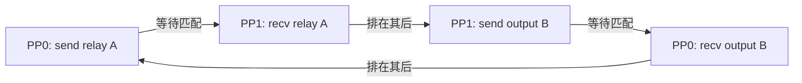

PP2 的通信死锁不能只解释成“异步 send 没完成”。需要说明哪笔 send 等哪笔 recv、recv 为什么不能执行，以及 MTP 改变了哪些消息和下一轮计算依赖。

本文核对日期为 2026-10-27，源码固定到 [`8252e3af630c103e960e13a77e570e810f8e3eb8`](https://github.com/sgl-project/sglang/tree/8252e3af630c103e960e13a77e570e810f8e3eb8)。这是源码导读和社区故障分析，**不是已经取得原始现场材料的 PPU 事故复盘**。涉及 NVIDIA CUDA / NCCL 的社区实测，不代表 PPU / PCCL 已验证相同内部行为。

## 可以确认的事实与缺失的现场材料

| 材料 | 能支持什么 | 不能支持什么 |
| --- | --- | --- |
| [PR #44453](https://github.com/sgl-project/sglang/pull/44453) | 非投机 PP2 也能出现 output 队列环；有 NCCL 最小复现和服务端对照结果 | 不能证明某次 PPU 故障就是同一个环 |
| [PR #30775](https://github.com/sgl-project/sglang/pull/30775) | 已合并的 PP + EAGLE/MTP relay 设计，以及 spec 场景的奇偶 rank 收发保护 | 不能证明某个内部 fork 采用了相同 draft 放置方式 |
| [PR #40499](https://github.com/sgl-project/sglang/pull/40499) | verify 轮保留交换优先；prefill/extend 轮可先计算以减少空闲 | 不是 PPU 现场验证记录 |
| 简历中的 PP0 等旧 output、PP1 等新 proxy 描述 | 提供待核对的故障线索和修复说法 | 不能替代分 rank 日志、通信序列、补丁和 wheel 记录 |

目前缺少那次 PPU 运行的启动参数、MTP 开关对照、分 rank 栈与日志、部署前后 diff、wheel 构建 SHA 和硬件回归结果。因此不能写成“当时已用日志证明根因”“独立实现了社区修复”或“在 PPU 上重新验证通过”。

相关 [issue #23162](https://github.com/sgl-project/sglang/issues/23162) 是 PP 与投机解码的设计 RFC，不是该次死锁的现场报告；其首尾 stage 放置 draft 的提案也不能替代 #30775 已合并实现。

## 先理解两个方向传什么

PP2 将模型层分给两个 stage。每个 stage 通常包含多个 TP rank；下文的 PP0 / PP1 表示两个 stage，画出的是其中对应通信进程之间的操作。

```text
模型前向：PP0 的模型层 → hidden states / proxy → PP1 的模型层
结果同步：PP1 的 output → PP0 → 转发 output → PP1
```

`proxy` 是后续模型层继续计算所需的中间张量。`output` 是 next token、logprob 或投机状态等结果。PP0 将收到的 output 再转发，是为了让所有 stage 在流水线进度上完成各自的结果处理。

chunk 是一段输入：长 prompt 分段处理，每段仍需经过全部 stage，并保留此前建立的 KV cache。microbatch 是调度槽位中的一批工作；不同 microbatch 可以属于不同请求，不能把 microbatch 与一个 prompt 的 chunk 等同。

## 最初看到什么现象

#44453 报告的社区现象是：跨节点 PP2 的 PD-prefill 部署中，并发请求错开少量时间进入不同 microbatch 后，两个 stage 停止推进。栈最终停在 `d2h_event.synchronize()`，之后 NCCL watchdog 报 PP device group 的 SEND 超时。该报告中的单请求或合入同一 microbatch 的请求没有触发。

这是社区作者的观察。对 PPU 现场只能保留“请求卡住、PP0 等 output、PP1 等 proxy”的待核对描述，不能补写未取得的时间戳、张量名或栈。

`d2h_event.synchronize()` 是等待点，不一定是根因：结果拷贝所依赖的设备操作如果被通信挡住，CPU 最后就会停在这里。仅凭这条栈，无法区分 P2P 顺序错误、其他 collective 阻塞或某个 rank 已退出。

## 怎么定位到异步通信顺序

把同一次复现的各 rank 操作按消息身份配对，才能从“卡在同步”走到“证明循环等待”：

1. 固定代码 SHA、启动参数、传输后端、请求输入和到达顺序；比较 MTP 开关、PP size=1/2，以及单 microbatch/多 microbatch。
2. 收集每个 rank 的最后调用栈和设备通信超时，确认所有进程仍存活，没有更早的 OOM、异常或请求状态分歧。
3. 在 output 与 proxy 的发起、wait、完成边界记录 `pp_rank`、对端、消息类型、microbatch 槽位、轮次和请求 ID。槽位会复用，不能只记 `mb_id`。
4. 对照 CPU 提交顺序、设备 stream/event 依赖和匹配 recv。必要时用 profiler 或通信后端诊断确认，不能把两个 rank 的日志行顺序直接当作设备执行顺序。
5. 把相同 P2P 顺序提取到不含模型计算的最小复现。如果仍卡住，而只调整收发顺序就恢复，才能把问题收敛到通信依赖。

调试日志优先写已经在 CPU 上的 ID、shape、dtype 和计数。不要为打印 GPU tensor 调用 `.cpu()`、`.tolist()` 或 `.item()`；额外同步会移动或掩盖故障。日志中的“已提交”与“已完成”应使用不同事件名。

## 第一个环：两笔 output send 互相挡住 recv

设 A、B 是两个在途 microbatch，PP0 已收到 A 的 output。错误队列的剩余顺序如下；每行从左向右执行：

```text
PP0：发送 relay(A)  → 接收 output(B)
PP1：发送 output(B) → 接收 relay(A)
```

这里 `relay(A)` 是 PP0 转发 A 的 output，不是 hidden-state proxy。



环中包含两种依赖：send 等对端匹配 recv；recv 又因本地队列前面的 send 尚未完成而不能推进。

`isend` 的 CPU 调用返回，不等于设备发送已完成。#44453 的 NCCL 复现表明，有限的连接缓冲可以暂时吸收未匹配发送，缓冲不足时就会暴露环。其特定 B300 / NCCL 2.30.7 实验中，NET/IB 与 NVLink 的阈值不同；这不是所有 NCCL 版本、消息大小或 PCCL 后端的固定阈值。

### 为什么开 MTP 更容易暴露

普通无附加输出的解码主要回传 `next_token_ids`。MTP 一轮要验证多个候选，relay 还需携带接受状态和下一轮候选：

| 源码字段 | 作用 |
| --- | --- |
| `spec_accept_lens` | 每个请求接受多少 token |
| `spec_new_seq_lens` | 接受后的序列长度 |
| `spec_bonus_tokens` | 下一轮候选的起点 |
| `spec_accept_index`（按需） | 接受路径的索引，用于对应状态提交 |
| `spec_next_chain` | 下一轮验证的候选 token |
| `spec_next_parents` / `spec_next_top_scores` | 重建相同候选树的结构信息 |

见 [`_pp_prepare_tensor_dict()`](https://github.com/sgl-project/sglang/blob/8252e3af630c103e960e13a77e570e810f8e3eb8/python/sglang/srt/managers/scheduler_pp_mixin.py#L789)。字段依赖具体轮次和可选结果，不是每轮都固定发送全部字段。

底层 [`send_tensor_dict()`](https://github.com/sgl-project/sglang/blob/8252e3af630c103e960e13a77e570e810f8e3eb8/python/sglang/srt/distributed/parallel_state.py#L1821)逐个 tensor 调用发送。MTP 因而增加连续排队的设备发送操作，不只是让一笔消息的字节数变大。

在仍采用错误 send-first 顺序的路径中，增加未匹配发送可能更早耗尽缓冲，暴露原有环。这是由消息结构和 NCCL 复现支持的机制解释，不是本文完成了同条件 MTP 开关实验。已执行奇偶配对的 PP-spec 路径若仍挂住，需要另查原因。

所以，“关 MTP 没挂，开 MTP 挂了”可以是一次有效的对照观察，但不能推出“非 MTP 不存在这个 bug”。#44453 已用非投机 PP2、并发不同 microbatch 和 logprob 请求复现。增加其他返回 tensor 也可能暴露同一类顺序问题。

### 改哪段逻辑

[`_pp_send_recv_and_preprocess_output_tensors()`](https://github.com/sgl-project/sglang/blob/8252e3af630c103e960e13a77e570e810f8e3eb8/python/sglang/srt/managers/scheduler_pp_mixin.py#L1463)按 PP rank 奇偶选择顺序。PP2 的配对变为：

```text
PP0：发送 relay(A)  → 接收 output(B)
PP1：接收 relay(A)  → 发送 output(B)
```

先匹配 A，再匹配 B，即使每笔发送都需要对端接收，也能推进。上游仍保留异步发送；不能把这个修复描述成“只把 async 改成 sync”。如果两端同时改成同步 send-first，仍可能互相等待。

## 另一类依赖：MTP 下一轮 verify 准备依赖旧回传

#30775 的实现将 draft worker 放在最后一个 stage。PP1 本轮运行 target verify，提交接受状态，进行 draft extend，并在轮尾提前生成下一轮候选。前面的 stage 不自行 draft，而是接收候选和结构，重建相同的 verify 输入。

源码链为：

```text
PP1: verify(t) → draft extend → 为 t+1 轮 draft
    → relay(t): 接受状态、序列长度、bonus token、候选(t+1)/结构
PP0: 接收并采用 relay(t) → 重建 verify 输入(t+1)
    → 本 stage target forward(t+1) → 向 PP1 发送 proxy(t+1)
```

见 [`EagleWorkerV2` 的 tail-draft](https://github.com/sgl-project/sglang/blob/8252e3af630c103e960e13a77e570e810f8e3eb8/python/sglang/srt/speculative/eagle_worker_v2.py#L1512)和 [`_pp_spec_rebuild_verify_input()`](https://github.com/sgl-project/sglang/blob/8252e3af630c103e960e13a77e570e810f8e3eb8/python/sglang/srt/managers/scheduler_pp_mixin.py#L1285)。

MTP 不仅增加消息，还增加“接收旧结果后才能准备新验证”的数据依赖。#30775 合并时的调度注释说明：树准备中的主机同步可能被旧通信阻塞，而对端仍等下一笔 proxy；#40499 也保留 verify 必须先交换结果的约束。

仅有上述数据依赖还不能独立证明现场死锁。要重建完整环，仍需定位具体准备操作、它等待的设备事件、事件前面的未完成通信，以及对端匹配操作为什么未执行。本文没有原始 PPU trace，不把这条依赖链冒充为已确认的第二个现场环。

对应修复在 [`_pp_exchange_outputs_before_forward()`](https://github.com/sgl-project/sglang/blob/8252e3af630c103e960e13a77e570e810f8e3eb8/python/sglang/srt/managers/scheduler_pp_mixin.py#L68)：

- 有异步 batch depth 时按既定流水线策略先交换。
- 零异步 depth 的 PP-spec 非末 stage，在 verify 轮先完成 output 交换，再准备并运行 forward。
- prefill/extend 轮不需要下一轮候选来启动，允许先计算；末 stage 也需要先执行相应计算以产生结果。

不能只改 output 交换函数里的奇偶顺序，却忽略 verify 准备放在事件循环的哪个位置。前一个修复处理已明确建模的通信队列环，这一个满足计算与回传之间的依赖。

## 中间 chunk 跳过通信解决什么

[`_pp_can_skip_output_comm()`](https://github.com/sgl-project/sglang/blob/8252e3af630c103e960e13a77e570e810f8e3eb8/python/sglang/srt/managers/scheduler_pp_mixin.py#L47)仅在开关启用、单请求 EXTEND、非最终 prefill chunk 且不返回 logprob 时跳过 output。中间 chunk 的 next token 本来不会加入回答，但 proxy 和 KV 建立仍需执行。

这个优化减少无用通信，不能替代 verify/decode 轮的收发顺序修复。双方还必须一致地跳过，并继续更新本地 chunk 进度，否则会出现对端空等或占位 token 被误用。

## 修复来自上游，还是做了适配

| 逻辑 | 可核对的上游来源 |
| --- | --- |
| PP-spec 候选 relay、spec 场景奇偶配对、verify 前交换 | #30775，合并提交 `25ce8063f7` |
| prefill/extend 先计算，verify 保持交换优先 | #40499，提交 `0229025127` |
| 普通 PP 也使用奇偶配对 | #44453，提交 `c5a5bf0d0b` |

`v0.5.22` 的奇偶配对条件仍为 XPU 或 `_pp_spec_relay`；#44453 将其推广到通用路径。若在 `v0.5.22` 开启了已受保护的 PP-spec 路径却仍挂住，不能仅凭现象归结为“缺少奇偶配对”：还要核对实际分支、verify 前交换、后端行为及其他依赖。

若要声称“在 PPU 上完成适配”，需要出示相对上述提交的额外 diff、PPU 后端/stream 语义、构建记录和回归结果。仅打包源码 wheel 不等于有额外算法或通信适配。目前没有这些材料，本文只归因到已知上游逻辑。

## 怎样验证真的解决了

### 第一层：匹配顺序回归

上游已有 [`test_pp_output_exchange_order.py`](https://github.com/sgl-project/sglang/blob/8252e3af630c103e960e13a77e570e810f8e3eb8/test/registered/unit/managers/test_pp_output_exchange_order.py)，调用实际 output 交换函数，检查两个在途 microbatch 的队首 send/recv 是否匹配，同时覆盖 spec relay 开关。

在满足该源码版本依赖的开发环境，从仓库根目录运行：

```bash
PYTHONPATH=python python test/registered/unit/managers/test_pp_output_exchange_order.py
```

这证明所建模的通信顺序可推进，不证明特定设备后端没有其他死锁。

### 第二层：设备通信最小复现

在相同硬件和传输设置上，只保留上文两组 P2P 队列，比较 send-first 与奇偶配对，逐步增加每条消息的 tensor 数。必须证明旧顺序能稳定失败、新顺序在相同负载下通过，不能只记录新版本一次成功。

#44453 提供了 NCCL 独立脚本和该实验的结果。PPU 需要使用实际部署的 PCCL/分布式后端重新做对应实验；不要将 NCCL 的缓冲阈值直接移用到 PPU。

### 第三层：服务与正确性回归

固定模型、checkpoint、代码、驱动/通信库、输入和到达顺序，在旧版本与补丁版本上对照：

| 对照维度 | 检查项 |
| --- | --- |
| MTP 开/关，PP size=1/2，单/多 microbatch | 限定触发范围，确认保护分支实际执行 |
| 短/长输入，单/多 chunk，logprob 开/关 | 增加连续 GPU tensor 或轮次，避免只测被缓冲掩盖的路径 |
| 同步到达/错峰到达，并发持续运行 | 请求全部完成，超时和 watchdog 为零，各 stage 持续推进 |
| 固定随机性与采样配置 | 输出 token、logprob、结束原因；数值允许有波动时声明容差 |
| MTP 接受结果 | 接受长度和候选有效性；只看文本正确会漏掉“候选全被拒绝而退化为普通生成” |
| 请求结束与失败路径 | KV/state 计数、释放、取消/超时后的继续服务能力 |
| 性能 | 同负载重复测量 TTFT、TPOT/吞吐，排除用全局同步掩盖故障而引入明显退化 |

#44453 的社区服务复现报告：旧顺序在三个独立启动中均挂住，配对顺序的对应 72 轮全部完成；这些是上游作者的 NVIDIA 实验，不是本文新增 PPU 测试。原简历的 150K 性能数据也没有在本文重新测量。

### 本次文档核对实际执行到哪一层

- 已从固定提交提取实际 output 交换函数，以无设备 stub 执行 spec relay 开/关两种情况；在每笔 send 都需要匹配 recv 的模型下，构造的全 send-first 反例无法排空，当前奇偶配对均可排空。没有声称受保护的旧 PP-spec 分支原本会失败。
- 已隔离执行实际 `_pp_exchange_outputs_before_forward()`，检查零异步 depth 的 PP-spec 非末 stage：verify 先交换、extend 先计算。
- 尝试运行完整 `test_pp_output_exchange_order.py`，但在导入阶段被本机 `flashinfer-cubin 0.6.13` 与 `flashinfer 0.6.14` 版本不一致阻断；未执行到测试断言，不记为通过。
- 未运行 NCCL/PCCL 设备复现、真实模型请求或性能 benchmark。前述验证矩阵是需要执行的回归要求，不是本次测试成绩。

## 如何回答“那次事故是怎么处理的”

没有原始材料时，可以准确表述为：

> 已核对社区与源码：PP2 的错误收发顺序可使两笔 output send 分别挡住对端所需的 recv；MTP 增加连续 GPU tensor 和下一轮 verify 对回传的依赖。上游分别用奇偶配对和 verify 前交换处理这些问题。现场是否命中同一个环、是否增加 PPU 适配，以及补丁后是否在原硬件通过，需要由当时的分 rank 日志、diff 与回归记录证明。

当原始材料齐备后，事故记录应给出“用户现象 → 两边等待点 → 完整依赖环 → 实际补丁 → 旧失败/新通过 → 正确性与性能回归”的证据链。不要把社区复现的日志改写成自己的现场日志。
